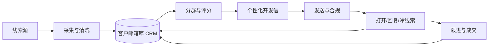
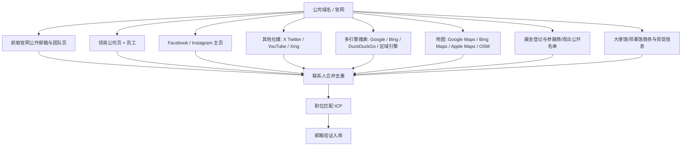

# Longxiang / Mouldible 外贸流程 AI 化项目方案

> 版本：v1.3  
> 日期：2026-10-19  
> 负责人：Rocky Lee（老板）  
> AI 技术协同：arthaschan  
> 执行助手：Grok Bot  
> 公司：Longxiang Group Limited（品牌 Mouldible）  
> 官网：[www.mouldible.com](https://www.mouldible.com)

---

## 1. 项目目标

把外贸开发从「人工搜客户 + 人工写邮件」升级为「可持续运转的获客系统」：

| 阶段 | 目标 | 成功标准（建议） |
|------|------|------------------|
| **第一步** | 建立目标客户邮箱数据库 | 90 天内积累 ≥ 5,000 条可验证 B2B 邮箱；字段完整率 ≥ 85%；无效邮箱率 < 8% |
| **第二步** | 点对点开发信规模化发送 | 日发送可控（建议起步 50–150/天/域名）；打开率、回复率可追踪；形成可复用话术与跟进节奏 |

**业务边界（本方案默认）：**

- 客户类型：海外采购商、品牌商、OEM/ODM、贸易公司、工业设计公司；以及中国以外的同行模具厂/注塑厂（产能溢出外发）  
- 行业：汽车件、家电、IT/消费电子、日用、办公配件等塑料注塑相关  
- 区域优先：北美、西欧、澳洲（与现有出口市场一致），再扩展全球  
- 不做：骚扰式群发、购买来源不明的脏数据、伪造身份/钓鱼话术

---

## 2. 总体架构（两步闭环）



**原则：**

1. **库是资产，信是流水线** — 先把数据质量做对，再放大发送量。  
2. **一人一信** — 每封邮件绑定具体公司/人/场景，禁止无模板无海量抄送。  
3. **可审计** — 每条邮箱要有来源、采集时间、验证状态、最近触达记录。  
4. **人机协作** — Grok Bot / AI 负责采集、清洗、起草、调度；你与销售确认高价值线索与关键节点。

---

## 3. 第一步：目标客户邮箱数据库

### 3.1 理想数据模型（最小可用字段）

| 字段 | 说明 | 必填 |
|------|------|------|
| `company_name` | 公司法定/常用名 | 是 |
| `website` | 官网 | 是 |
| `country` / `region` | 国家/地区 | 是 |
| `industry` | 行业标签（汽车、家电…） | 是 |
| `contact_name` | 联系人姓名 | 否 |
| `job_title` | 职位（Purchasing / Sourcing / Engineer…） | 否 |
| `email` | 工作邮箱 | 是 |
| `email_status` | valid / catch-all / invalid / unknown | 是 |
| `phone` / `linkedin` | 补充渠道 | 否 |
| `source` | 数据来源（展会名录、官网、目录站…） | 是 |
| `source_url` | 原始链接 | 是 |
| `collected_at` | 采集时间 | 是 |
| `score` | 匹配分（0–100） | 是 |
| `owner` | 跟进人 | 否 |
| `last_contacted_at` | 最近开发时间 | 否 |
| `lifecycle` | new / contacted / replied / opportunity / do_not_contact | 是 |
| `notes` | 备注（产品兴趣、模具吨位等） | 否 |

建议技术落库：**Google Sheets / Airtable / Notion DB（起步）→ 后期 Postgres + 简易 CRM**。起步用表格即可，字段先统一。

### 3.2 目标客户画像（ICP）

优先采集同时满足越多越好的公司：

1. 有塑料件/注塑件/模具采购或自制转外发需求  
2. 年采购或品类与 Mouldible 能力匹配（汽车内外饰、家电壳体、电子结构件等）  
3. 决策链可见：Purchasing Manager、Sourcing、Supply Chain、Project Engineer、CTO/Owner  
4. 官网有英文或目标市场语言；有工厂/品牌痕迹  
5. 排除：纯个人邮箱海量注册站、明显的一次性域名、已明确拒绝联系者

### 3.3 线索来源（按合规与质量排序）

| 优先级 | 来源 | 做法 | 备注 |
|--------|------|------|------|
| P0 | 展会名录 / 老客户转介绍 / 官网询盘 | 结构化入库 | 质量最高 |
| P0 | 目标公司官网 Contact / About / Team | 爬取或人工+AI 抽取邮箱 | 注意 robots 与频率 |
| P1 | 行业目录、协会会员名录、海关/进出口公开情报（合法渠道） | 公司清单 → 再找邮箱 | 先有公司再找人 |
| P1 | LinkedIn / 职场公开资料 | 找人 → 用公司域名猜测+验证 | 遵守平台条款 |
| P1 | 多引擎搜索 + 地图 + 展会名录深化 + 使馆商务信息（见 §3A） | 交叉检索公开邮箱/电话；地图核地址；展会参展商/观众公开名单；使馆商务处企业名录与贸促页 | 六大渠道与官网/社媒同级 |
| 禁止 | 不明来源「邮箱包」、撞库、破解、伪造表单抓取 | — | 法律与品牌风险高 |

### 3.4 邮箱获取方法（推荐流水线）

```text
公司名单 → 解析官网域名 → 找公开邮箱 / 模式猜测
        → 邮箱验证（语法+MX+SMTP探测）
        → 去重 → 打分入库
```

**常见企业邮箱模式（在验证后使用）：**

- `firstname.lastname@domain`
- `f.lastname@domain`
- `firstname@domain`
- `purchasing@` / `sales@` / `info@` / `enquiry@`（通用邮箱可入库，但开发信转化通常低于个人职邮）

**验证分层：**

1. 格式校验  
2. 域名 MX 记录  
3. 第三方验证服务（ZeroBounce、NeverBounce、MillionVerifier 等择一）  
4. 标记 catch-all，发送更保守

### 3.5 采集产能与节奏（建议）

| 阶段 | 时间 | 周产能目标 | 重点 |
|------|------|------------|------|
| 试点 | 第 1–2 周 | 300–500 条高质量 | 定字段、定 ICP、定验证 |
| 放大 | 第 3–8 周 | 800–1,500 条/周 | 多源并行、自动去重 |
| 稳态 | 第 9 周起 | 持续补库 + 清洗 | 无效邮箱清除、生命周期更新 |

### 3.6 第一步交付物

1. 《ICP 与标签字典》  
2. 《数据字典 + 库表模板》（CSV/Sheet）  
3. 《采集 SOP》（来源、频率、禁止项）  
4. 可运行的采集脚本/Grok Bot 例行任务（按国家或行业批次）  
5. 每周《库健康报告》：总量、新增、验证通过率、Top 国家/行业

### 3.7 Grok Bot 在第一步的职责

- 按行业/国家批量检索目标公司并整理清单  
- 从公开网页抽取联系方式并结构化  
- 去重、补全字段、生成 score  
- 输出待人工抽检样本（每周 5%）  
- 例行：工作日早上报告库增长与异常（可与现有 GitHub 例行类似另建）

---


---

## 3A. 多渠道职位与联系人挖掘（Rocky 要求）

邮箱不是终点。对每一个目标公司，用 **多种方式** 挖决策人职位与更多联系方式，再汇总进同一张客户表。

**多渠道原则（v1.3，Rocky 确认）：** 富化须把以下 **六大渠道** 全部写入同一 enrichment 流水线（同等重要，非事后补漏）：

1. **公司官网** — Contact / About / Team / Impressum 等公开页  
2. **社媒** — LinkedIn、Facebook、Xing（DACH）及其他公开主页  
3. **多引擎搜索** — Google、Bing，及 DuckDuckGo / 本地欧盟或区域引擎等  
4. **地图** — Google Maps、Bing Maps、OpenStreetMap 等（地址、电话、周边相关企业）  
5. **展会 / 展览登记与参展商·观众名单**（各类展会登记数据）— 如 K Show、Fakuma、NPE、Chinaplas 海外名录，及塑料/模具类展会的公开参展商目录、合法可获的观众登记线索  
6. **大使馆 / 领事馆商务与贸易板块**（各大使馆商务信息）— 商务参赞页、贸促页、企业名录、目标市场伙伴/招标名单  

不得只做「官网 + LinkedIn/Facebook/Xing」。

### 流程（每个公司跑一遍）



### 渠道与做法

| 渠道 | 挖什么 | 怎么做 | 产出字段 |
|------|--------|--------|----------|
| **公司官网** | Contact / About / Team / Imprint / 页脚邮箱 | 打开站点抓 `mailto:`、表单旁公开邮箱、人名+职称 | email, name, title, source=website |
| **LinkedIn（领英）** | 公司主页、员工列表、Purchasing/Sourcing/Tooling/Design 等职位 | 搜公司名 → 找相关职位联系人 → 记录个人资料 URL；再结合域名猜邮箱并验证 | linkedin_url, name, title, email_guess |
| **Facebook** | 公司主页、About 中的邮箱/电话/网站、留言区公开联系 | 搜公司官网域名或公司名 → 记录主页与公开邮箱/Messenger | facebook_url, phone, email |
| **Instagram / X** | 品牌主页 bio 链接、对外邮箱 | 作为补充，尤其消费品牌类 OEM | social_urls |
| **Xing（德语区）** | 德国/瑞士/奥地利决策人 | 与 LinkedIn 类似，Formenbau 客户常用 | xing_url |
| **多引擎搜索** | 公开邮箱片段、人名+职位、迁址新域名、新闻稿联系人 | 对同一公司名/域名在 **Google、Bing**，以及有用时的 **DuckDuckGo / 本地欧盟或区域引擎** 交叉检索；模板如：`公司名 + email/contact/phone`、`site:domain contact`、`"injection mould" OR Formenbau + 城市`；摘要中的电话/邮箱入库并标注来源引擎 | email_source=search_*, phone, name, title, source_url |
| **地图（Maps）** | 工厂/办公地址、地图列表电话、周边相关企业 | **Google Maps、Bing Maps、Apple Maps / OpenStreetMap**（能开则开）：搜公司名或品类+城市 → 记录列表页地址与电话、官网链接；查看附近同类模具厂/注塑厂作扩池；与官网 Impressum 地址交叉校验 | address, phone, maps_url, nearby_peers |
| **展会 / 展览登记与名录**（各类展会登记数据） | 参展商目录、公开观众/买家登记线索、展位联系人 | 优先塑料/模具展：**K Show、Fakuma、NPE、Chinaplas** 及区域模具/注塑展；从官方 exhibitor directory、公开 PDF/Excel、行业协会汇总入库；仅用**合法可公开获取**的登记数据；与官网/社媒交叉验证 | source=trade_show, show_name, booth, email, phone, name |
| **大使馆 / 领事馆商务信息**（各大使馆商务信息） | 商务参赞与贸促页、目标市场企业名录、伙伴推荐、公开招标/采购清单 | 目标国中国使领馆经商处、驻华使领馆贸易处、商会/贸促会公开页；搜「commercial counsellor / trade section / company directory」+ 国家；摘录公开联系邮箱与企业清单，标注 `source=embassy` | source=embassy, country, email, company_name, source_url |

### 职位挖掘优先级（多方式交叉）

1. **采购 / 寻源：** Purchasing Manager, Sourcing Manager, Buyer (Tooling/Plastics)  
2. **产品 / 项目：** NPD Manager, Project Manager, Product Development  
3. **技术：** Tooling Engineer, Mechanical Engineer (plastics), Industrial Designer  
4. **老板层（中小厂）：** Owner, Managing Director, CEO（海外同行外发场景特别有效）  
5. **销售接口（同行外发）：** Sales Manager / Key Account（对方接单过满时转包）

同一人可能出现在官网 Team + LinkedIn；以「人」为键合并，保留所有来源链接。

### 表字段扩展（在原库上增加）

| 字段 | 说明 |
|------|------|
| `contact_name` | 联系人姓名 |
| `job_title` | 职位 |
| `email` | 已验证或待验证邮箱 |
| `email_source` | website / linkedin_guess / facebook / imprint / search_google / search_bing / search_other / maps / trade_show / embassy / other |
| `linkedin_url` | 个人或公司领英 |
| `facebook_url` | 公司脸书 |
| `other_social` | Xing / IG / X 等，JSON 或分号分隔 |
| `phone` | 公开电话（官网 / 地图列表 / 搜索摘要交叉） |
| `address` | 工厂或办公地址（优先地图+Impressum 互证） |
| `maps_url` | Google/Bing/Apple/OSM 列表链接 |
| `show_name` | 展会名称（K Show / Fakuma / NPE / Chinaplas 等），无则空 |
| `embassy_country` | 使领馆对应目标国（如有） |
| `enrichment_status` | pending / partial / done |
| `icp_tag` | oem_buyer / design_studio / sourcing / overseas_peer_overflow / other |

### 执行节奏建议

- **批量：** 先对高分域名做「官网邮箱抓取」；  
- **六渠道并行：** 每家公司至少覆盖官网 + 社媒公开页 + 多引擎查询 + 地图列表；并按战役拉取相关 **展会公开名录** 与 **使馆/贸促企业目录**；结果合并去重。  
- **加深：** 每周挑 50–100 家做领英+脸书深挖；展会季优先吃完该展 exhibitor PDF/目录。  
- **工具：** Grok Bot 负责打开公开页、搜索摘要、地图列表、展会目录与使馆贸促页整理；领英登录态由你授权后在我的电脑浏览器操作；禁止违规爬取或买脏库。  
- **合规：** 只使用公开展示或合法可获的联系方式（展会/使馆公开名单同理）；社媒私信作辅助，主通道仍是工作邮箱一对一开发信。

### 与两步目标的关系

- **第一步建库：** 关键词找公司 → 官网+社媒+**多引擎搜索+地图+展会名录+使馆商务信息**挖人挖邮 → 验证入库（量质并重）。  
- **第二步发信：** 优先有「姓名+职位+验证邮箱」的记录；仅有 `info@` 的排后或用通用信箱短模板。


## 4. 第二步：点对点开发邮件

### 4.1 核心原则

1. **一对一**：一封邮件 = 一个收件人（或明确的一人主送）  
2. **有钩子**：提到对方产品线、料号品类、地区法规、近期新闻中的一点真实信息  
3. **短**：首封建议 80–150 英文词；中文客户另案  
4. **可回复**：只问一个低门槛问题（如「是否接受中国模具供应商报价？」）  
5. **可退订**：正文提供停止联系方式；尊重回复  

### 4.2 邮件类型（序列）

建议 4 封序列（间隔工作日），未回复再停或转入长尾：

| 序号 | 时机 | 目的 | 内容要点 |
|------|------|------|----------|
| #1 | Day 0 | 破冰 + 能力证明 | 对方品类 + Mouldible 相关案例（汽车/家电等）+ 1 个 CTA |
| #2 | Day 3–4 | 补证据 | 交期、吨位、出口国经验、质检流程；附官网案例链接 |
| #3 | Day 7–8 | 社会证明 | 出口 38 国 / 3000+ 套模具中的相关垂直案例（不夸大） |
| #4 | Day 12–14 | 礼貌收尾 | 询问是否合适时机；提供 WhatsApp/邮箱；同意则移除序列 |

**高意向回复**（要图纸、要报价、约会议）→ 立刻转人工（你或业务员），AI 只做草稿与资料整理。

### 4.3 个性化变量（最低集）

- `{{first_name}}` / `{{company}}`  
- `{{product_hint}}`（从官网推断的产品一句）  
- `{{country}}`  
- `{{case_line}}`（匹配行业的一句案例）  
- `{{sender_name}}`（Rocky Lee / 指定业务员）  
- `{{calendar_or_whatsapp}}`

Grok Bot 可为每条线索生成 `product_hint` 与 `case_line`，人工抽检高分线索。

### 4.4 发送基础设施（必须先搭好再放量）

| 组件 | 建议 | 说明 |
|------|------|------|
| 发信域名 | 独立子域，如 `mail.mouldible.com` 或专用域名 | 保护主站域名声誉 |
| DNS | SPF + DKIM + DMARC | 上线前检测通过 |
| 发信工具 | Instantly / Smartlead / Lemlist / Mailreach 等，或自建 + Amazon SES（需暖号） | 选带序列与追踪的 |
| 暖号 | 新域名/新邮箱暖 2–4 周 | 从每天几十封缓慢升 |
| 每日上限 | 起步 30–50/邮箱，逐步到 50–150 | 多邮箱轮换优于单邮箱爆量 |
| 追踪 | 打开、点击、回复、退弹 | 退弹立即停发并改库状态 |

**发件人身份建议：**

- 对外：`Rocky Lee | General Manager | Mouldible / Longxiang`  
- 签名含：官网、工厂城市、WhatsApp、工作邮箱 `rockylee@longxiang-ltd.com`

### 4.5 合规与风控（外贸必做）

1. **仅 B2B 商务联系**；保留来源与同意/合理利益说明（尤其欧盟 GDPR）  
2. 提供明确 **opt-out**；24 小时内处理退订  
3. 不购买来源不明列表；不伪装成已有合作关系  
4. 内容真实：产能、认证、案例可核对  
5. 敏感市场（欧盟、加州等）用更严模板与更低频率  
6. 建立 `do_not_contact` 黑名单并全局生效

> 本方案定位为合法 B2B 开发辅助。具体法律文本建议由公司顾问按目标市场审阅。

### 4.6 效果指标（KPI）

| 指标 | 试点健康区间（经验值） | 动作 |
|------|------------------------|------|
| 硬退弹率 | < 3% | 升高则停发、重验库 |
| 打开率 | 40%–60%（因工具与行业差异大） | 低则改主题行 |
| 回复率 | 3%–8%（优质一对一） | 低则改钩子与名单质量 |
| 正向意向率 | 回复中的询价/要资料比例 | 优化 ICP |
| 会议/报价数 | 周统计 | 对齐销售产能 |

### 4.7 第二步交付物

1. 《英文开发信序列模板 v1》（#1–#4）  
2. 《主题行 A/B 池》  
3. 《发信域名与暖号清单》  
4. 《每日发送与跟进 SOP》  
5. 仪表盘：发送、打开、回复、机会  

### 4.8 Grok Bot 在第二步的职责

- 按线索生成个性化首封与跟进稿（你确认后发送）  
- 维护序列状态机：该发哪一封、谁该停  
- 回复分类：询价 / 拒绝 / 稍后 / 转介绍 → 建议下一步  
- 起草报价前问卷、会议纪要、跟进提醒  
- **默认：不自动群发**；量大时也建议「生成 → 你或业务一键批准 → 发出」

---

## 5. 90 天实施路线图

### 第 0 周：准备

- [ ] 确认 ICP 国家与行业优先级（建议先：US / DE / UK / AU + 汽车或家电二选一做深）  
- [ ] 建库表模板与权限（老板只读总览，arthaschan 可写技术字段）  
- [ ] 选定邮箱验证商 + 发信工具试用  
- [ ] 准备发信子域与 DNS  
- [ ] 法务过一遍退订与隐私说明短文

### 第 1–2 周：试点（库 + 信）

- [ ] 人工+AI 做出 **300** 条高质量线索  
- [ ] 验证通过后选 **50–100** 条发序列 #1  
- [ ] 记录打开/回复，迭代主题与首段  
- [ ] 固定周会：Rocky + arthaschan + Grok Bot 纪要

### 第 3–6 周：放大采集

- [ ] 库规模冲到 **2,000–3,000**  
- [ ] 发信升到稳定日额度（多邮箱）  
- [ ] 建立「高分线索人工优先」队列  
- [ ] 网站 mouldible.com 增加对应落地页（行业案例 + 询盘表）

### 第 7–12 周：体系化

- [ ] 库 ≥ **5,000** 可验证邮箱  
- [ ] 序列自动化（批准制）  
- [ ] 回复 → 商机 CRM 字段打通  
- [ ] 复盘：哪个国家/行业 ROI 最高，砍掉低质源

---

## 6. 团队分工

| 角色 | 职责 |
|------|------|
| **Rocky Lee** | 定 ICP、批价格策略、谈大客户、批准对外口径与预算 |
| **arthaschan** | 采集/验证/发信工具对接、脚本与仓库、数据质量、与 Grok Bot 协作开发 |
| **Grok Bot** | 方案执行辅助、批量研究与草稿、例行监控、文档与周报 |
| **业务/跟单（若有）** | 处理询价、样品、合同；反馈话术真实度 |

GitHub 仓库 `lee-lwj/ai` 建议作为本项目代码与自动化脚本主仓；arthaschan 已获邀请（待其接受 Write 权限）。

---

## 7. 技术栈建议（务实版）

| 层级 | 起步（0–3 月） | 进阶（3–12 月） |
|------|----------------|-----------------|
| 客户库 | Google Sheet / Airtable | Postgres + 简易后台 |
| 采集 | Grok Bot 浏览器研究 + 手工 + 轻量脚本 | 定向爬虫队列 + 代理与限速 |
| 验证 | 一家验证 SaaS API | 自建预检 + SaaS 终检 |
| 发信 | Instantly / Smartlead 等 | 多域名池 + 自有分析 |
| AI | Grok Bot 生成与分类 | 自有提示词库 + 评分模型 |
| 协作 | 本对话 + 周报 MD | Notion/飞书项目空间 |

---

## 8. 预算量级（粗估，可按实报价调整）

| 项 | 月费量级（USD） | 说明 |
|----|-----------------|------|
| 邮箱验证 | 50–300 | 按验证条数 |
| 发信工具 | 50–200+ | 按席位/邮箱数 |
| 域名与基础设施工具 | 20–80 | 子域、监控 |
| 数据源/名录（可选） | 0–500+ | 仅正规供应商 |
| 人力 | 以 arthaschan 投入为主 | 比工具更关键 |

建议：**先花在验证与域名声誉，再花在买量。**

---

## 9. 风险与对策

| 风险 | 对策 |
|------|------|
| 邮箱质量差 → 退弹伤域名 | 先验证再发送；硬退弹 >3% 熔断 |
| 话术像群发 | 强制个性化字段；抽检 10% |
| 法律投诉 | 退订链路 + 来源记录 + 区域策略 |
| 销售跟不上询盘 | 限制日发送；高意向自动提醒老板 |
| 数据孤岛 | 统一 `lifecycle`；禁止多份 Excel 并行 |

---

## 10. 近期可执行的「最小闭环」（建议本周做完）

1. 冻结 ICP：先做 **美国 + 家电或汽车** 其中一条产品线。  
2. 建 Sheet 库表（按第 3.1 字段）。  
3. 用 Grok Bot 产出 **首批 50 家目标公司** 并尽量补邮箱。  
4. 写好英文序列 #1 草稿（Rocky 改口径）。  
5. 若发信工具未就绪：先「生成个性化邮件 → 你手动发 20 封」验证话术。  
6. 建项目周报模板，每周五更新库规模与回复数。

---

## 11. 成功定义（6 个月）

- 可验证 B2B 邮箱库 **≥ 8,000**，且月活清洗  
- 稳定月询盘/有效回复达到你设定的业务目标（需你补充：期望每月几条有效询价）  
- 开发信流程无需老板盯每封，只需批高意向与例外  
- arthaschan 可独立维护采集与发送管道；Grok Bot 承担研究与文案负荷  

---

## 12. 待你确认的决策点

请尽快拍板以下事项，以便进入实施：

1. **优先国家**：第一批只做哪 1–2 个？  
2. **优先行业**：汽车 / 家电 / 消费电子 / 其他？  
3. **发件人**：统一用 Rocky，还是业务员分邮箱？  
4. **语言**：默认全英文，还是按国家切换？  
5. **月目标**：希望每月多少封有效询价或多少次会议？  
6. **工具偏好**：能否接受付费验证 + 发信 SaaS？  
7. **库存放**：Google Sheet 是否可用？（与你的 Google 账号一致则最佳）

---

## 13. 附录 A — 首封开发信结构（英文骨架）

```text
Subject: {{product_hint}} tooling partner from Guangzhou?

Hi {{first_name}},

I noticed {{company}} {{product_hint}}. We are Mouldible (Longxiang Group),
a plastic injection mould maker in Guangzhou with 18+ years exporting to 38 countries.

{{case_line}}

Would you be open to a quick note on whether you currently source moulds
or moulded parts from Asia?

Best regards,
Rocky Lee
General Manager, Mouldible / Longxiang Group Limited
https://www.mouldible.com
WhatsApp: +86 13178879403
```

（正式启用前由你改案例与语气。）

---

## 附录 B — 文档与仓库建议目录

```text
lee-lwj/ai/
  docs/
    外贸AI化项目方案.md          ← 本文件
    icp.md
    email-sequences/
    weekly-reports/
  data/
    schema.csv
  scripts/                       ← arthaschan 维护
```

---

*本方案由 Grok Bot 根据 Rocky 提出的两步目标（建库 → 点对点开发信）及 Mouldible 公开业务信息整理。v1.2：多渠道 enrichment 纳入多引擎搜索与地图。v1.3：六大渠道全部一等公民——官网、社媒（LinkedIn/Facebook/Xing）、多引擎搜索、地图、展会登记/参展商名录、大使馆商务信息。*
